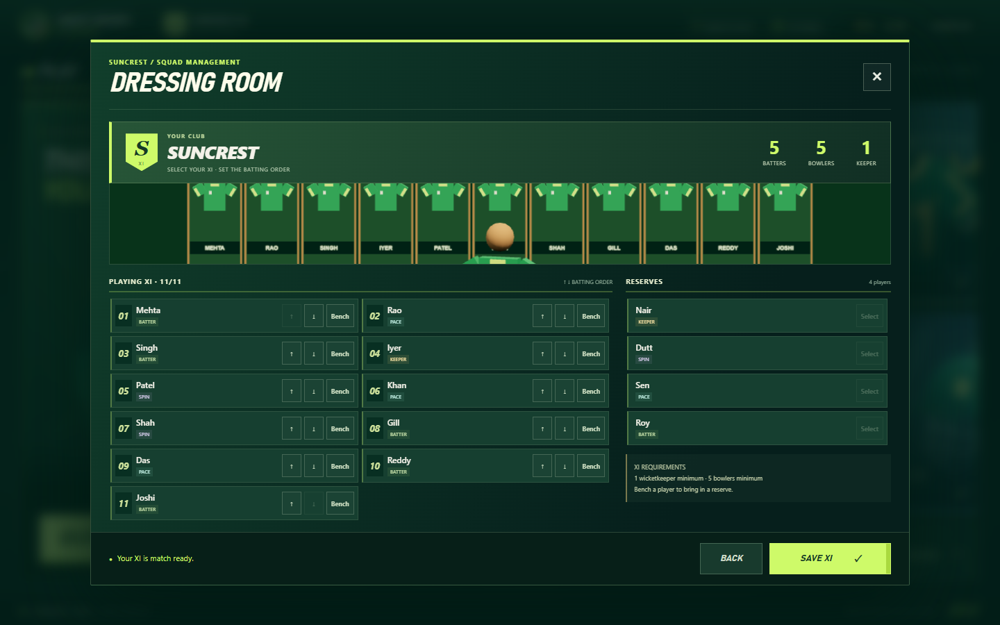
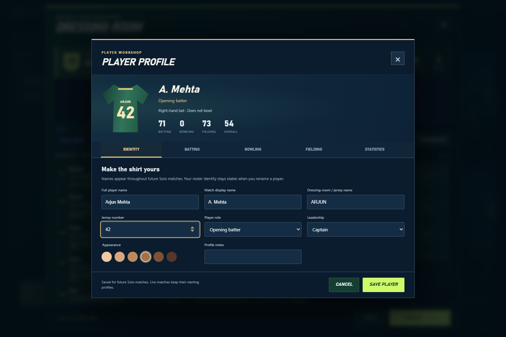
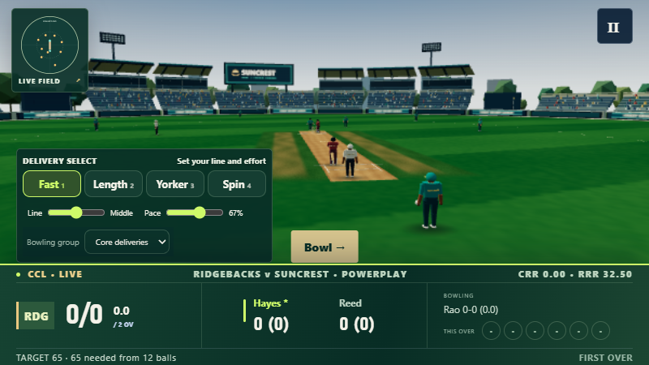
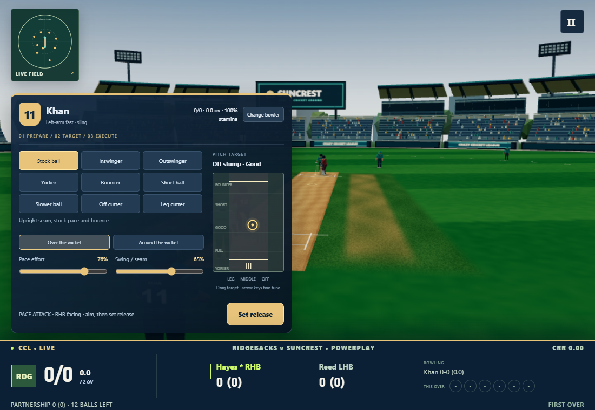
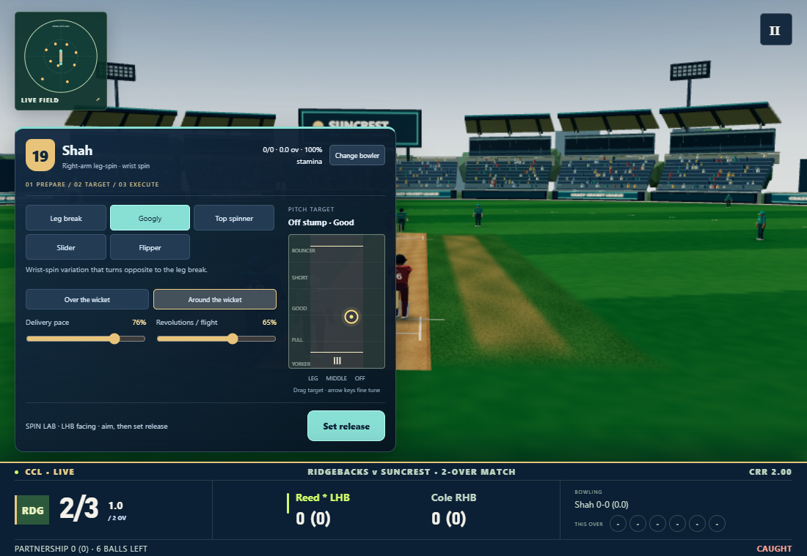
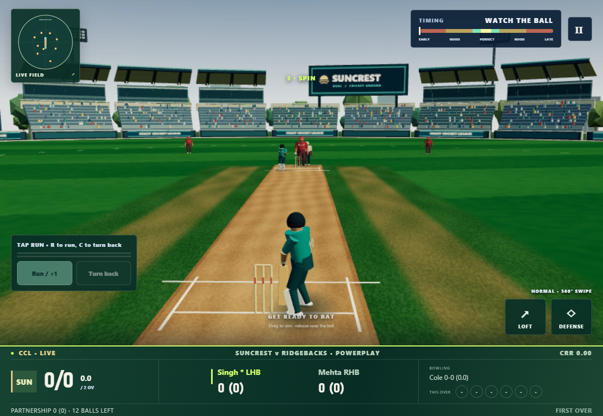
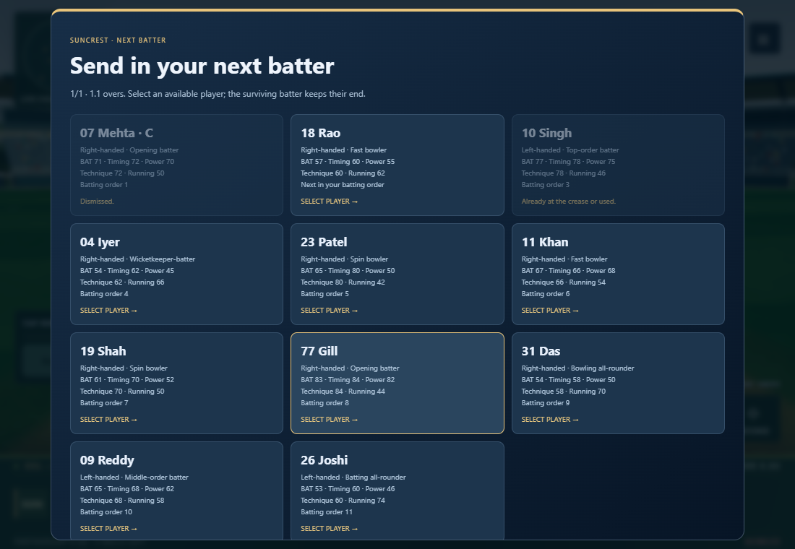

# CCL bowling and player-management implementation report

Implemented 8 November 2026. The enhanced match experience is enabled in **Solo**. Profiles, editing, comparison and persistent squad configuration are available in the dressing room. Training, Longest Six and the existing online protocol retain their established delivery contracts; see compatibility and limitations below.

## A. Research findings

The [official WCC3 overview](https://www.worldcricketchampionship.com/wcc3) supports varied controls, advanced AI and professional motion capture. Its [official FAQ](https://www.worldcricketchampionship.com/cricket/world-cricket-championship-3/guides) describes three-discipline player skills and squad stamina/recovery. The [GamingOnPhone guide](https://gamingonphone.com/guides/world-cricket-championship-3-beginners-guide-and-tips/) documents wicket-side choice, a timed merit tracker, compatible special deliveries, speed/movement adjustment and pitch targeting. [AnimationXpress's 2021 coverage](https://www.animationxpress.com/games/wcc3-introduces-dedicated-esports-mode-alongwith-bunch-of-other-features/) confirms assignable bowling actions and new presentation sequences.

Those references support interaction principles, not CCL's physics constants or UI. CCL's pitch map, two-press execution control, numerical attributes, action curves, player-choice rules, accuracy model and camera are original. No WCC3 artwork, animation clips, branding or code is used.

Research limits: the GamingOnPhone page returned HTTP403 directly; its indexed bowling section was available. The [official video catalogue](https://www.worldcricketchampionship.com/cricket/world-cricket-championship-3/videos) and linked “Batting, Bowling and Fielding upgrades” demonstration were identified, but the embedded video fetch was throttled. Frame-by-frame video playback was not independently verified. The detailed controls are attributed to the written guide, not to claimed observation of unavailable footage. These dated references are not a claim that every current WCC3 version uses identical controls.

## B. Existing architecture

The previous game had one fixed-step `Delivery` simulation with eight recipes, name-keyed batting/bowling tendencies, a three-second visual windup, automatic five-bowler rotation and numbered batter replacement. Procedural segmented athletes already had batting IK, running, fielding, shadows and graphics quality budgets. Bowling used a single hardcoded arm.

Solo, Training and Six use the local controller. Online Quick, Private and Duo reconstruct server-owned accepted commands using the shared simulation and replay engine. SQLite stores online matches and sealed results. The innings reducer owns score, extras, strike and figures. H1–H6 were inspected; H6's independent runner grounding/retreat and all prior law fixes remain in the shared engine.

The implementation extends these existing systems. The old name-keyed tendencies remain a compatibility adapter for legacy modes and historical commands; the editable profile model is the source for new Solo matches. [Audit and implementation plan](bowling-milestone-plan.md).

## C. New bowling workflow

1. Choose an eligible bowler at innings start and each completed over. Cards show jersey identity, arm/type/action, skill, pace or spin, accuracy, control, stamina, figures, economy and recent deliveries. Unavailable cards state the reason.
2. Select a compatible variation. The scrollable pace tray and spin tray are generated from the chosen profile; mastery requirements lock special variations.
3. Choose over/around the wicket. Drag the pitch marker for line and length, or focus it and use arrow keys. Target zones cover outside leg through wide off, and yorker through bouncer length.
4. Adjust pace and movement. Pace bowlers control swing/seam; spinners control revolutions/flight and delivery pace.
5. Press **Set release**, then **Release now** in the gold region. Space performs the same action. The accepted execution quality is recorded numerically, independently of rendering.
6. Watch the selected bowler accelerate, gather, plant, release and follow through. The ball begins from the shared physical release endpoint when the windup finishes. The HUD contracts during flight.
7. Feedback reports release quality and target error. The white pitch marker shows the simulated bounce; excessive effort, inaccurate line/length and illegal deliveries follow actual simulation facts.

## D. Fast bowling

Types: fast, medium-fast and medium, with either arm. Implemented variations: stock ball, inswinger, outswinger, reverse swing, yorker, toe yorker, bouncer, short ball, slower ball, off cutter, leg cutter and cross seam.

Maximum pace caps physical speed. Effort, pace control, accuracy, skill, swing/reverse swing, seam, yorker/bouncer/slower-ball skill, consistency, variation mastery and workload affect speed, scatter or movement. Cutters change post-bounce direction; slower balls reduce speed; reverse swing acts later in flight; short/full recipes change intended bounce. Poor high-effort execution can overstep. Excessive head-height deliveries are no-balls in the new path.

## E. Spin bowling

Types: right-arm off-spin, right-arm leg-spin, left-arm orthodox and left-arm wrist-spin. Finger-spin repertoires provide off break/orthodox turn, arm ball and top spinner; doosra requires appropriate off-spin mastery. Wrist spin provides leg break, googly, top spinner, slider and sufficiently mastered flipper. Left orthodox also supports slider.

Spin has its own flight/loop, drift, release height, pace range, bounce and post-pitch turn. Arm and wrist rotation determine movement direction. Googly and doosra reverse their stock break; top spin adds bounce with little lateral turn; slider/flipper stay lower and quicker; arm ball reduces turn. Spin, flight, drift, turn, control and mastery affect these trajectories. These are distinct simulation recipes, not renamed stock deliveries.

## F. Handedness

Bowling arm changes the active anatomical shoulder/hand, front foot, action coil and release coordinate. Over/around shifts the release across the crease. Batter-relative line is converted into world space for either batting hand. Eight arm × batting-hand × wicket-side combinations are tested.

Left batting changes stance, crease position, feet, grip assignment, blade motion, pad/LBW interpretation and stroke-family selection. Swipe direction remains a world-space aiming direction, so the ball travels where the gesture points. The rig mirrors kinematics and grips without negative mesh scaling. Existing longitudinal running/grounding remains authoritative.

## G. Player profiles

The version2 model separates these fields from presentation and match statistics:

| Group | Editable fields |
|---|---|
| Identity | Full/display/jersey name, jersey number, captain/vice-captain, skin tone, profile notes; stable roster ID is immutable |
| Batting | Hand, style, preferred position, skill, power, timing, technique, shot control, running, consistency, aggression |
| Bowling | None/occasional/regular/specialist capability, arm, type, action, skill, maximum pace, pace control, accuracy, control, swing, reverse swing, seam, yorker, bouncer, slower ball, spin, flight, drift, turn, mastery, stamina, consistency |
| Fielding | Rating, catching, throwing accuracy/power, agility, reflexes, ground fielding, wicketkeeping |
| Role | Opening/top/middle-order/specialist batter, finisher, keeper-batter, fast/spin specialist, all-rounder, batting all-rounder, bowling all-rounder |

Names and ranges are validated, along with arm/type/action compatibility and role/capability requirements. Keepers need suitable keeping ability; specialists/all-rounders need usable configurations. The editor exposes relevant pace or spin ratings. Timing/technique/control/power/consistency affect batting; running affects individual runner speed; fielding ratings affect chase, collection and throws. Style labels and preferred batting position describe selection intent; they do not silently override the explicitly saved XI order.

## H. Squad and match management

The dressing room supports XI/reserve selection, player editing, batting-order arrows, filters, rating sorting, two-player comparison, captaincy and persistent individual career figures. An invalid XI opens the squad for repair rather than starting an impossible match. Profile changes do not mutate an active match.

Solo lets the user choose both openers and every incoming batter. Dismissed/used players cannot re-enter. The innings reducer records the vacated end after run-out crossing and over-end strike changes, and the entrance presents that end's incoming player. DRS settles before replacement. AI follows the selected batting order.

Bowling eligibility respects capability, active/interrupted overs, consecutive-over prohibition, per-bowler quotas and reduced-format extra-over allowances. A feasibility check prevents choices that would leave no legal rotation for the final overs. AI uses the same eligibility and weighs skill, accuracy, control, fatigue, handedness, figures and match pressure. Its delivery choices vary tactically, favor death-over yorkers when appropriate and cannot bypass capability or numeric limits.

Local profiles are stored under `ccl.players.v2`; the first save backs up original legacy data. Unknown older fields are retained, malformed/future records remain stored, and unavailable storage reports an error. Per-player career aggregation is idempotent and keyed by stable ID, including when two players share a display name. [Schema and persistence detail](player-profile-design.md).

## I. Animation and graphics

Six original action families—high arm, sling, smooth, side-on, finger spin and wrist spin—combine with bowling arm and type. They have distinct run distances, strides, gather, front-foot plant, shoulder coil, wrist/arm arc, follow-through and recovery. Release IK meets the deterministic endpoint. Batting retains two-hand grip and grounded footwork for both hands. The incoming batter walks to the correct crease with a brief introduction.

Main athletes have reusable256px jersey textures, real dressing-room names/numbers, individual skin materials and existing kit/fabric details. The bowling camera closes toward release while retaining the flight corridor. Reduced motion provides a fixed readable view. Resize handling now avoids clearing a completed frame on redundant observer callbacks.

Visual review corrected an anatomical arm-index error, a jersey stripe crossing the number, narrow-screen profile overflow, an oversized landscape editor, excessive HUD height, stale wicket-side previews, and first-frame canvas sizing. [Animation implementation and pose evidence](bowling-animation.md).

| Before | After |
|---|---|
|  |  |
|  |  |







The pre-existing squad/bowling screenshots above document the previous implementation. An additional fresh baseline run was captured under `bowling-evidence/before/`. New integrated screenshots cover targeting, mobile/landscape, run-up, release, pace/spin flight, entrance, stance and replacement. Pose sheets separately cover all arm/action identities and jersey readability.

## J. Files changed

See [complete file manifest](bowling-files.md), including each source, test, report and evidence artifact. Main code is organized into profile/store/editor, bowling recipes/selection, HUD/controller and pure animation modules. The PRD is unchanged.

## K. Testing

| Check | Result |
|---|---|
| Complete default unit suite (`npm test`) | **303 passed, 0 failed, 0 skipped**, 10.005s |
| Complete unit suite, serialized | **303 passed, 0 failed, 0 skipped**, 36.85s |
| New engine tests | **44 passed**: delivery capabilities, arm/hand/side, target/error, speed/turn/bounce, illegal balls, replay, batting/fielding effects, wickets, quotas and rotation feasibility |
| Profile tests | **38 passed**: schema, roles, validation, migration, persistence, names, IDs and career |
| New animation tests | **6 passed**, plus15 existing batting/player-motion checks in the focused run |
| Solo gameplay browser | **10 check groups passed**, no page/console errors; real input, legal over, replay, spin, openers and real wicket replacement |
| Squad browser | **6 check groups passed**,13 screenshots, no page/console errors |
| Animation browser | **11 pose studies passed**, no page errors |
| Final real-time presentation browser | **4 check groups passed**: canvas/scene visibility, left-around preview coordinate, real-time quality samples and responsive bounds; no page/console errors |
| Production build / TypeScript | **Passed**, native Vite config loader; existing large-chunk warning only |
| Existing Online, Duo, Six browser scripts | **All three passed**; server scoring/reconnect/rematch, shared innings/running/swaps, challenge replay/persistence |

Exact commands and machine configuration:

```powershell
node --test --test-concurrency=1 tests/*.test.ts
node node_modules/typescript/bin/tsc --noEmit
node 'C:\Program Files\nodejs\node_modules\npm\bin\npm-cli.js' run build -- --configLoader native
$env:CCL_CHROME_PATH='C:\Users\hp\AppData\Local\ms-playwright\chromium-1248\chrome-win64\chrome.exe'
$env:CCL_SOFTWARE_GPU='1'
node scripts/bowling-browser.ts
node scripts/squad-browser.ts
node scripts/bowling-animation-browser.ts
node scripts/bowling-presentation-browser.ts
node scripts/online-browser.ts
node scripts/duo-browser.ts
node scripts/six-browser.ts
```

An earlier default-parallel run during simultaneous software-rendered browser tests had one existing Duo timing fixture fail: real RTT compensation changed an expected catch. Its unchanged isolated four tests, the complete serialized 303-test run, and the final ordinary `npm test` run with all 303 tests passed. This is recorded rather than suppressing RTT compensation or weakening assertions. The new gameplay observer only reads state; it does not inject outcomes. Its virtual clock is not used for FPS measurements.

Regression logs: [unit](bowling-evidence/regression/unit-results.txt), [engine](bowling-evidence/regression/engine-results.txt), [online](bowling-evidence/regression/online-results.txt), [Duo](bowling-evidence/regression/duo-results.txt), [Six](bowling-evidence/regression/six-results.txt). Browser assertions and snapshots: [Solo](bowling-evidence/after/checks.json), [squad](visual-evidence/bowling/squad/checks.json).

## L. Performance

The real-time presentation run is recorded in [performance.json](bowling-evidence/after/performance.json). It measures five-second ready-scene samples at Low and High quality without a virtual clock. These are headless SwiftShader software-rendering observations on this Windows host, not hardware GPU benchmarks or a mobile60FPS claim.

At1100×760, Low measured **7.22FPS** (37 frames in5.12s, median139ms, p95167ms;276 calls/81,900 triangles). High measured **2.95FPS** (15 frames in5.09s, median395.8ms, p95437.4ms;397 calls/128,702 triangles). High reported93 geometries and14 textures, including the three reusable identity textures. These small samples establish that this software renderer is slow; they do not certify competitive frame rate. Hardware acceleration and Low quality remain important for this machine.

The fresh pre-change High baseline at1280×591 had297 draw calls,118,674 triangles,71 geometries and11 textures, with median frame562.6ms under software rendering. Scene/viewport differ from the final ready-scene sample, so those timings are not an apples-to-apples speedup measurement. Each isolated new bowler rig study uses about2,326 triangles and24 calls including its ground and ball.

Optimization: three bounded reusable hero jersey textures; repaint only on identity changes; cached geometries/materials and existing quality levels; unchanged expensive shader/shadow budgets; no allocations of new jersey textures per selection; no per-frame resize layout read; unused materials/textures disposed through existing cleanup. Repeated editor transitions retain one editor/preview renderer. This is evidence of bounded resource behavior, not a long-duration heap-leak certification. The existing production bundle size warning remains.

## M. Compatibility

- New Solo deliveries include a version1 immutable bowling snapshot, batting/fielding attributes, stable player IDs and match-name snapshots. Replay reads those values rather than the mutable profile store.
- Legacy deliveries without the optional snapshot take the previous arithmetic path. Online input validation still rejects unsupported extra fields; clients cannot submit their own outcome or profile snapshot.
- Quick/Private/Duo preserve server authority, command ordering, anti-duplication, reconnect, score reconstruction, SQLite schema, wallets and sealed history. An online rollout requires a negotiated protocol and server-owned profiles; it was not silently introduced.
- Training/Six retain their previous drill recipes and controls. New profile customization is currently applied to Solo gameplay; it is not silently applied to online opponents or old drill results.
- No saved SQLite row, finalized scorecard, sealed checksum or historical result is rewritten. Browser profile migration preserves original data. Existing local matches were session-only; this work does not add resume-after-reload for an unfinished Solo match.

## N. Remaining limitations

- The full enhanced bowling/profile command path is Solo-only. Online and drill rollout remains future work as described above.
- The original rigs remain stylized procedural athletes: no motion capture, cloth, facial or individual finger animation. Six reusable action families do not equal hundreds of bespoke professional-player clips.
- Fitness currently uses legal balls bowled; wides/no-balls do not add separate fatigue cost, and squad recovery scheduling is not modeled.
- Batting style, preferred position and role assist selection/configuration; there is no learned batter-weakness database or independent form system. Explicit saved batting order remains authoritative.
- Retired hurt and substitutions were absent in the existing controller and remain unsupported. There is no new licensing, asset pack, online profile sync or cloud profile backup.
- Browser coverage is Chromium on Windows, with desktop/portrait/landscape sizes; physical touch devices, Safari and sustained hardware-GPU/mobile performance were not certified. The pitch target supports pointer/touch capture and keyboard input.
- Written WCC3 references were verified; embedded demonstration playback was unavailable. The implementation makes no claim to reproduce undocumented WCC3 physics or exact animation.
